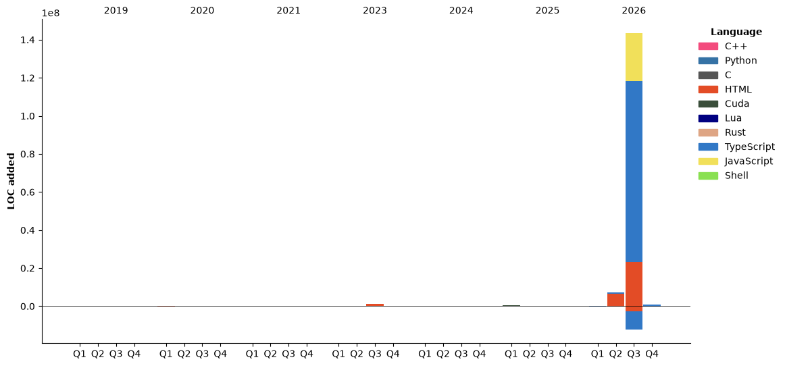

- 👋 Hi, I’m @Kanekicn
- 👀 I’m interested in Algorithm development.
- 🌱 I’m currently learning C++, Python, Web development.

<!---
cotecsz/cotecsz is a ✨ special ✨ repository because its `README.md` (this file) appears on your GitHub profile.
You can click the Preview link to take a look at your changes.
--->

<!--START_SECTION:waka-->


**🐱 My GitHub Data** 

> 📦 2.8 MB Used in GitHub's Storage 
 > 
> 🏆 294 Contributions in the Year 2026
 > 
> 🚫 Not Opted to Hire
 > 
> 📜 31 Public Repositories 
 > 
> 🔑 24 Private Repositories 
 > 
📅 **I'm Most Productive on Thursday** 

```text
Monday                   6607 commits        ███░░░░░░░░░░░░░░░░░░░░░░   12.94 % 
Tuesday                  7546 commits        ████░░░░░░░░░░░░░░░░░░░░░   14.77 % 
Wednesday                5590 commits        ███░░░░░░░░░░░░░░░░░░░░░░   10.94 % 
Thursday                 9327 commits        █████░░░░░░░░░░░░░░░░░░░░   18.26 % 
Friday                   8271 commits        ████░░░░░░░░░░░░░░░░░░░░░   16.19 % 
Saturday                 5155 commits        ███░░░░░░░░░░░░░░░░░░░░░░   10.09 % 
Sunday                   8581 commits        ████░░░░░░░░░░░░░░░░░░░░░   16.80 % 
```


📊 **This Week I Spent My Time On** 

```text
💬 Programming Languages: 
Other                    47 hrs 47 mins      █████████████████████████   99.92 % 
Text                     2 mins              ░░░░░░░░░░░░░░░░░░░░░░░░░   00.08 % 

🔥 Editors: 
Chrome                   47 hrs 49 mins      █████████████████████████   100.00 % 

💻 Operating System: 
Mac                      47 hrs 49 mins      █████████████████████████   100.00 % 
```

🤖 **AI Coding This Week** 

```text
No AI Coding Activity Tracked This Week
```

**I Mostly Code in TypeScript** 

```text
TypeScript               17 repos            ███████████░░░░░░░░░░░░░░   45.95 % 
HTML                     5 repos             ███░░░░░░░░░░░░░░░░░░░░░░   13.51 % 
Python                   4 repos             ███░░░░░░░░░░░░░░░░░░░░░░   10.81 % 
JavaScript               1 repo              █░░░░░░░░░░░░░░░░░░░░░░░░   02.70 % 
Shell                    1 repo              █░░░░░░░░░░░░░░░░░░░░░░░░   02.70 % 
```


**Timeline**




 Last Updated on 27/10/2026 21:05:37 UTC
<!--END_SECTION:waka-->
